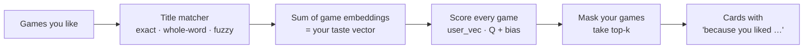

<div align="center">

# 🎮 GameSense

### Tell it the games you love. It finds the ones you'll play next.

Personalized Steam game recommendations powered by a matrix-factorization model trained on real player data.
Pure NumPy inference, no retraining, no placeholder data.

<br>

[](https://gamesense-v2.streamlit.app/)
[](https://github.com/AhsanCS64/GameSenseV2)
[](https://ahsanhabibkushal.vercel.app/)


**[Try it live →](https://gamesense-v2.streamlit.app/)** • **[GitHub Repository →](https://github.com/AhsanCS64/GameSenseV2)** • **[Portfolio →](https://ahsanhabibkushal.vercel.app/)**

</div>

<!--
  Add a screenshot or GIF of the app here, e.g.:
  <p align="center"></p>
-->

---

## ✨ What it does

Pick a few games you enjoy and GameSense returns a ranked list of games you're likely to enjoy too. Every recommendation comes with a reason:

> **"Because you liked *Portal 2*"**

That line names the game from your list that pulls hardest toward the recommendation, so you can see *why* something was suggested instead of trusting a black box.

## 🚀 Features

| | |
|---|---|
| 🔎 **Smart search** | Searchable multiselect of all **993 titles**, most-played first. Selections appear as removable chips. |
| ✍️ **Free-text input** | Type one title per line. Matching goes **exact → whole-word → fuzzy** (difflib ≥ 0.75) and tells you what matched and what wasn't found. |
| 💡 **Explainable results** | Every card shows rank, title, *"Because you liked …"*, and the player count from the dataset. |
| ⚡ **Instant updates** | Recommendations refresh on every change. Choose 3–30 results with the slider (default 10). |
| 🎲 **Quick start** | One-click top-5 most-played games, plus a **Surprise me** button that adds 3 popular picks. |
| 🖼️ **Cover art** | Optional Steam store covers (cached). Falls back to letter placeholders, so the app works fully offline. |
| 📥 **Export** | Download your recommendations as CSV. |
| 🌗 **Light / dark theme** | Toggle in the sidebar, with a responsive layout, keyboard navigation and visible focus states. |
| 🧾 **About the model** | A plain-language drawer with the evaluation metrics and the data caveat below. |

## 🧠 How it works

GameSense uses **history-based matrix factorization**. Instead of storing one vector per user (which would break for anyone new), your taste vector is *built on the fly from the games you list*:

```text
user_vec  = Σ H[i] for each liked game i  /  n^alpha
score(j)  = user_vec · Q[j] + b[j]
```

- `H` and `Q` are learned game embeddings (input and output sides), and `b` is a per-game popularity prior.
- Games you already listed are masked out, and the top-*k* remaining scores are returned.
- The "because you liked" game for a recommendation *j* is the liked game *i* with the highest `H[i] · Q[j]`.



### Training and evaluation

- **Data:** the real [Steam Video Games (Tamber)](https://www.kaggle.com/datasets/tamber/steam-video-games) dataset. A game counts as "liked" when the user played it for at least a minimum number of hours.
- **Training:** each step hides part of a user's games and teaches the model to rank the hidden ones first, using a full-softmax loss with no negative sampling. This is the same task it faces when you type in your own list.
- **Selection:** embedding size and regularization were chosen by validation NDCG@10 with early stopping.
- **Evaluation:** users are held out entirely. Half of each user's games are shown to the model and the other half must be recovered. It is compared against *Popularity* and *Item-item cosine* baselines on Hit@10, Recall@10 and NDCG@10. The numbers are in [`eval_report.md`](eval_report.md).

> **Heads-up:** the underlying dataset was collected around **2016**, so newer games aren't in the catalog.

## 📁 Project structure

```text
GameSense/
├── app.py                      # Streamlit app: model loading, title matcher, NumPy inference, UI
├── gamesense_artifacts.npz     # Trained arrays H, Q, b, alpha (read-only)
├── games.json                  # titles + n_players (same row order as the artifacts)
├── config.json                 # Training settings (informational)
├── eval_report.md              # Offline test metrics
├── requirements.txt            # Pinned, tested dependencies
├── tests/
│   └── test_app.py             # pytest suite
└── .streamlit/
    └── config.toml             # Dark gaming theme
```

## 🛠️ Run it locally

```bash
# 1. Clone
git clone <your-repo-url>
cd GameSense

# 2. Create and activate a virtual environment
python -m venv .venv
# Windows PowerShell:
.venv\Scripts\Activate.ps1
# Git Bash / macOS / Linux:
source .venv/bin/activate        # Git Bash on Windows: source .venv/Scripts/activate

# 3. Install dependencies
pip install -r requirements.txt

# 4. Launch
streamlit run app.py
```

Then open the local URL Streamlit prints (usually <http://localhost:8501>).

> On Windows, if `python` isn't found, use `py -m venv .venv` and `py -m streamlit run app.py`.

## ✅ Tests

```bash
python -m pytest -q
```

The suite covers title normalization, all three matching stages, that games you list are **never** recommended, and that results are deterministic.

## ☁️ Deploy on Streamlit Community Cloud

1. Push this folder to a GitHub repo (everything is well under GitHub's 100 MB file limit).
2. Go to [share.streamlit.io](https://share.streamlit.io) and choose **Create app**.
3. Select your repo and branch, and set the **main file path** to `app.py`.
4. Under **Advanced settings**:
   - Requirements file: `requirements.txt`
   - Python version: `3.11` (requirements are pinned accordingly)
   - Secrets / environment variables: none needed
5. Deploy. The app reads `gamesense_artifacts.npz` and `games.json` by paths relative to `app.py`, so it works straight from the repo.

> Using Python 3.12+? Update `requirements.txt` to `numpy==2.5.2` and `pandas==3.0.5`.
> Free Streamlit apps go to sleep when idle, so the first visit after a quiet spell may take a few seconds to wake up.

## 🧩 Tech stack

- **App:** Streamlit, NumPy, pandas
- **Model training:** PyTorch (training only; the deployed app has no PyTorch dependency)
- **Matching:** Python `difflib` and whole-word search over normalized titles
- **Testing:** pytest

## 🙏 Acknowledgements

- Dataset: [Steam Video Games](https://www.kaggle.com/datasets/tamber/steam-video-games) by Tamber on Kaggle, built from public Steam data.
- Cover art, when shown, comes from the public Steam store.

## 👤 Author

Built by **[H. M. Ahsan Habib Kushal](https://ahsanhabibkushal.vercel.app/)**
- **Portfolio:** [ahsanhabibkushal.vercel.app](https://ahsanhabibkushal.vercel.app/)
- **GitHub:** [@AhsanCS64](https://github.com/AhsanCS64)
- **Repository:** [AhsanCS64/GameSenseV2](https://github.com/AhsanCS64/GameSenseV2)

---

<div align="center">

If GameSense helped you find your next favorite game, consider leaving a ⭐

</div>
